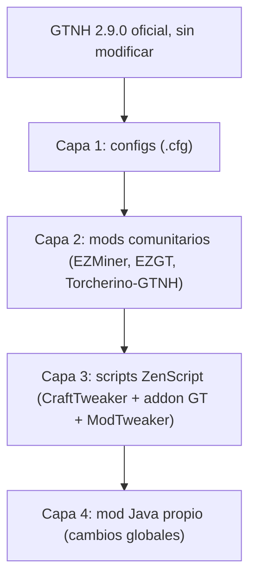

# GTNH Easy Mode · "Sin tedio"

> **Proyecto comunitario NO oficial.** No está afiliado ni respaldado por el equipo de GregTech: New Horizons (GTNH). Es una **capa (overlay) que se instala encima del GTNH oficial**, no un fork. Si juegas con esta capa, **no reportes bugs al GTNH oficial** sin reproducirlos antes en una instancia limpia.

**Idea:** mantener el **grind tecnológico** de GTNH (tiers, cadenas de producción, multibloques, logística y quests) y quitar el **grind tedioso**:
- criar abejas y cruzar cultivos concretos;
- esperar a que las plantas crezcan;
- minar a mano;
- no poder volar;
- la lentitud de los mods de magia;
- un AE2 que llega demasiado tarde.

- Versión de referencia: **GTNH 2.9.0** (Minecraft 1.7.10). Análisis del 2026-11-04.
- Leyenda:
  - ✅ verificado en fuente primaria (configs o código de GTNH 2.9.0)
  - 🟡 probable, hay que probarlo
  - ⚠️ dudoso o inferido

## ¿Es posible? Sí

Todo lo pedido es viable **sin forkear GTNH**. La mayoría se resuelve con **configs y scripts ZenScript**: CraftTweaker, el addon de GregTech y ModTweaker ya vienen en GTNH 2.9.0 ✅. Solo los cambios globales necesitan un **mod Java pequeño**: multiplicar todos los tiempos, mutaciones al 100 % o bajar el voltaje mínimo de una máquina.

| Objetivo | ¿Viable? | Cómo, en resumen | Esfuerzo | Confianza |
|---|---|---|---|---|
| Abejas sin cría tediosa | Sí | - Forestry `mode=HARD` → `EASY` - Industrial Apiary barato por script - Mutaciones al 100 % con mod Java | Medio | ✅ config · 🟡 resto |
| Cultivos concretos sin cruces | Sí | - CropsNH ya es determinista: los cruces son recetas en NEI - Semillas y granja industrial más baratas por script | Medio | ✅ / 🟡 |
| Tiempo de crecimiento | Sí | - HungerOverhaul: multiplicadores `2` → `1` - World Accelerator barato - Mod Java para CropsNH | Bajo | ✅ config |
| Minería manual | Sí | - EZMiner: minado de vetas GT - Ore Drilling Plant y Void Miner más baratos por script | Bajo | ✅ / 🟡 |
| Vuelo creativo | Sí | Cualquiera de estas: - ServerUtilities `fly=true` (comando `/fly`) - Angel Ring (hoy IV) bajado a LV - Vuelo para todos en mod propio | Bajo | ✅ / 🟡 |
| Magia más directa y rápida | En su mayoría | - Thaumcraft `research_difficulty=-1`: investigación con puntos - Thaumcraft `wuss_mode=true`: sin Warp - ModTweaker para abaratar infusiones, altar y runas | Medio-alto | ✅ config · 🟡 ModTweaker |
| **AE2 entero a LV**, incluida la **Creative Energy Cell** | Sí | - Recetas alternativas a ≤30 EU/t por script: 94 recetas de GT están por encima de LV - `UsageMultiplier` 10 → 1 - Canales opcionales | Medio | ✅ inventario · 🟡 recetas |
| Esperas largas de máquinas | Sí | - EZGT o Torcherino-GTNH, con valores moderados - Multiplicador global de duración en mod propio | Bajo / medio | ✅ / 🟡 |

Detalle por área, con archivos y claves exactas: [docs/viabilidad.md](docs/viabilidad.md).

## Qué se queda igual

- Los tiers y su orden, las cadenas de producción y los multibloques.
- Las quests como guía de progresión, con notas "Easy" donde cambie algo.
- La logística: tú sigues diseñando las fábricas.

## Arquitectura: overlay en 4 capas

- **Por qué overlay y no fork:**
  - GTNH incluye mods cerrados con permisos concedidos *a GTNH*, que no se transfieren a un derivado. Un overlay no redistribuye esos jars.
  - Es mucho más fácil seguir cada versión nueva de GTNH.
  - Detalles en [docs/arquitectura.md](docs/arquitectura.md) y [docs/legal.md](docs/legal.md).
- **Presets:** "Sin tedio" (base) y "Turbo" (añade aceleración de máquinas), como los modos de Nomi-CEu y Monifactory ([docs/precedentes.md](docs/precedentes.md)).

## Estructura del repo

| Carpeta | Contenido |
|---|---|
| [`config/`](config/) | Cambios de configuración: archivo, clave, valor de GTNH y valor Easy |
| [`scripts/`](scripts/) | Scripts ZenScript que se copian a `<instancia>/scripts/`. El primero es AE2 a LV. |
| [`docs/`](docs/) | Viabilidad, arquitectura, legal, precedentes e [informe previo "GTNH sin grind"](docs/investigacion-gtnh-sin-grind.md) |

Pendiente:
- `mods.md`: lista de mods externos con enlaces, nunca jars.
- `install.ps1` / `install.sh`.
- El mod Java, en `mod/`.

## Hoja de ruta

| Fase | Entregable | Estado |
|---|---|---|
| 0. Fundación | Este repo: visión, viabilidad, arquitectura y legal | Hecho |
| 1. MVP de configs | Archivos `.cfg` cambiados, EZMiner y script de instalación | Pendiente |
| 2. Scripts | - AE2 a LV, con Creative Energy Cell - Angel Ring a LV - Apiarios y granja baratos - Magia por ModTweaker | Pendiente |
| 3. Mod Java | - Multiplicador global de tiempos - Vuelo opcional para todos - Mutaciones al 100 % - Crecimiento de CropsNH | Pendiente |
| 4. Pulido | - Notas "Easy" en las quests - Traducciones ES/EN - CI que empaqueta el zip en cada tag | Pendiente |
| 5. Mantenimiento | Rama por versión de GTNH y checklist de actualización | Continuo |

## Cómo contribuir

1. Abre un issue con la propuesta y responde: **¿quita tedio o quita progresión?** Solo entra lo primero.
2. Indica el archivo y la clave (configs), o la receta original y la nueva (scripts).
3. Pruébalo en un mundo nuevo con GTNH 2.9.0 y esta capa.
4. **Nunca subas jars de terceros** al repo, solo enlaces.

## Licencia

Pendiente de decidir, con una condición fija:
- Los archivos de configuración y quests **derivados de GTNH** deben publicarse bajo **CC BY-NC-SA 4.0**, la licencia del repo de GTNH ✅. Eso implica atribución y sin uso comercial.
- Para scripts y código propios se sugiere MIT.

Ver [docs/legal.md](docs/legal.md).
